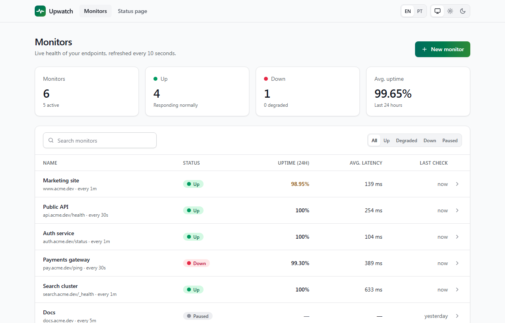
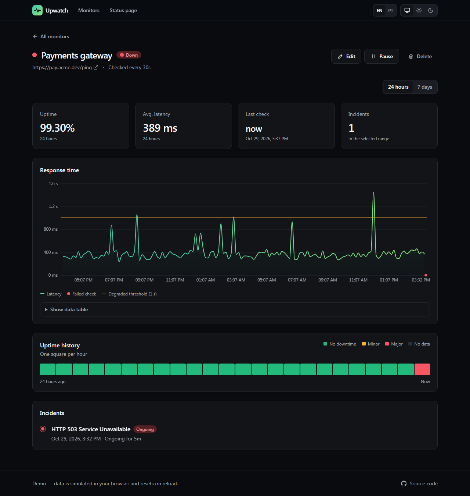
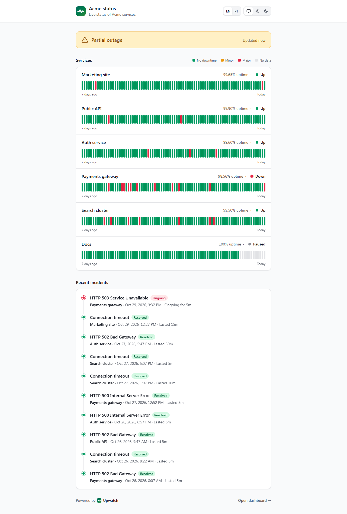

# Upwatch

[](https://github.com/BielBabilonia/Upwatch/actions/workflows/ci.yml)

**Uptime monitoring dashboard and public status page**, inspired by Better Stack and Atlassian Statuspage.
Track response time and availability of your endpoints, get incidents opened and closed automatically,
and share a public status page with your users.

**Live demo:** _add your Vercel URL here_

> The whole backend is simulated in the browser with [MSW](https://mswjs.io), so the demo is fully
> interactive — create, edit, pause and delete monitors — with no server. Data resets on reload.



| Monitor detail (dark) | Public status page |
| --- | --- |
|  |  |

## Features

- **Live dashboard** — summary cards, search and status filters, responsive table (desktop) and cards (mobile).
  Data refreshes every 10 seconds with TanStack Query polling.
- **Monitor detail** — latency chart with failed checks marked, 24h / 7d range (kept in the URL),
  GitHub-style uptime history, incident timeline, and an accessible data-table alternative to the chart.
- **CRUD with optimistic updates** — create/edit in a validated modal form (Zod), pause/resume and delete
  update the UI instantly and roll back on error. Toast notifications, confirmation before deleting.
- **Public status page** (`/status`) — overall banner ("All systems operational" / partial outage),
  per-service uptime bars for the last 7 days, recent incidents.
- **Realistic simulation** — 7 days of seeded history, live checks generated per monitor interval,
  Markov-style outages, latency spikes, incidents that open and resolve on their own.
- **Polish** — dark/light/system theme without flash, English and Brazilian Portuguese, keyboard and
  screen-reader friendly (native `<dialog>`, skip link, labelled controls, status never shown by color alone).

## Tech stack

| Area | Choice |
| --- | --- |
| UI | React 19, TypeScript (strict), Vite |
| Styling | Tailwind CSS v4 with semantic design tokens (CSS variables) |
| Server state | TanStack Query (polling, optimistic mutations, query key factory) |
| Routing | React Router (route-level code splitting) |
| Validation | Zod v4 — every type is inferred from a schema, API responses are parsed at runtime |
| Charts | Recharts |
| API mocking | MSW v3 (Service Worker in the browser, Node server in tests) |
| Testing | Vitest + Testing Library, Playwright (desktop + mobile) |
| CI / Hosting | GitHub Actions, Vercel |

## Architecture

```
src/
  api/          schemas.ts (Zod), client.ts (typed fetch + ApiError), queries.ts (hooks, keys, mutations)
  mocks/        db.ts (in-memory simulation), handlers.ts (REST API under /api), browser.ts
  features/
    monitors/   list, detail, chart, uptime bar, form, delete dialog
    incidents/  incident timeline
    status-page/
  components/   ui/ primitives (Button, Card, Modal, Toast, ...) and layout/
  lib/          formatters, status rules, small hooks
  i18n/         typed EN + PT-BR dictionaries
  theme/        system/light/dark preference
```

Some decisions worth calling out:

- **The API boundary is validated.** `api/client.ts` parses every response with Zod and throws a typed
  `ApiError` (`http` / `network` / `parse`), so UI code never sees unvalidated data.
- **Server state lives only in TanStack Query.** No global store; local UI state stays in components.
  Mutations patch the list and detail caches optimistically and restore a snapshot on failure.
- **Status rules are shared** between the mock backend and the UI (`lib/status.ts`):
  paused > down (last check failed) > degraded (last check slower than 1 s) > up.
- **MSW runs in production** to make the demo work without a backend. The app renders immediately and
  requests wait for the worker to be ready, so users see skeletons instead of a blank page.
- **Performance** — pages are code-split and Recharts (the heaviest dependency) is loaded in parallel
  with the detail page's data. Relative timestamps tick in a leaf component so polling and clocks
  don't re-render whole pages.

### Mock API

| Method | Endpoint | Notes |
| --- | --- | --- |
| GET | `/api/monitors` | List with status, 24h uptime and average latency |
| GET | `/api/monitors/:id?range=24h\|7d` | Detail with downsampled checks |
| POST | `/api/monitors` | Validated with the same Zod schema as the form |
| PATCH | `/api/monitors/:id` | Partial update, including `paused` |
| DELETE | `/api/monitors/:id` | Also removes its incidents |
| GET | `/api/incidents?monitorId=` | Last 7 days, newest first |

## Getting started

Requires Node.js 24+.

```bash
npm install
npm run dev          # http://localhost:5173
```

| Script | What it does |
| --- | --- |
| `npm run dev` | Dev server |
| `npm run build` | Type-check and production build |
| `npm run preview` | Serve the production build |
| `npm run lint` | ESLint |
| `npm run typecheck` | TypeScript, no emit |
| `npm test` | Unit and component tests (Vitest) |
| `npm run test:e2e` | End-to-end tests (Playwright; run `npx playwright install chromium` once) |

## Testing

- **Unit** — formatters, status rules, uptime bucketing, the simulation and the API client
  (schema mismatches, HTTP and network errors).
- **Component / integration** — pages rendered with the real router, providers and MSW handlers:
  filtering, empty and error states, form validation, create / edit / pause / delete flows, status page.
- **End-to-end** — create a monitor, view its detail, pause and delete it, status page, persisted
  theme and language; on desktop and mobile viewports against the production build.

## Quality

Lighthouse on the production build: **100** in Accessibility, Best Practices and SEO on every page.
Performance (desktop) is 97–98 on the dashboard and status page. The monitor detail page scores lower
because rendering the Recharts chart blocks the main thread on slow devices.
